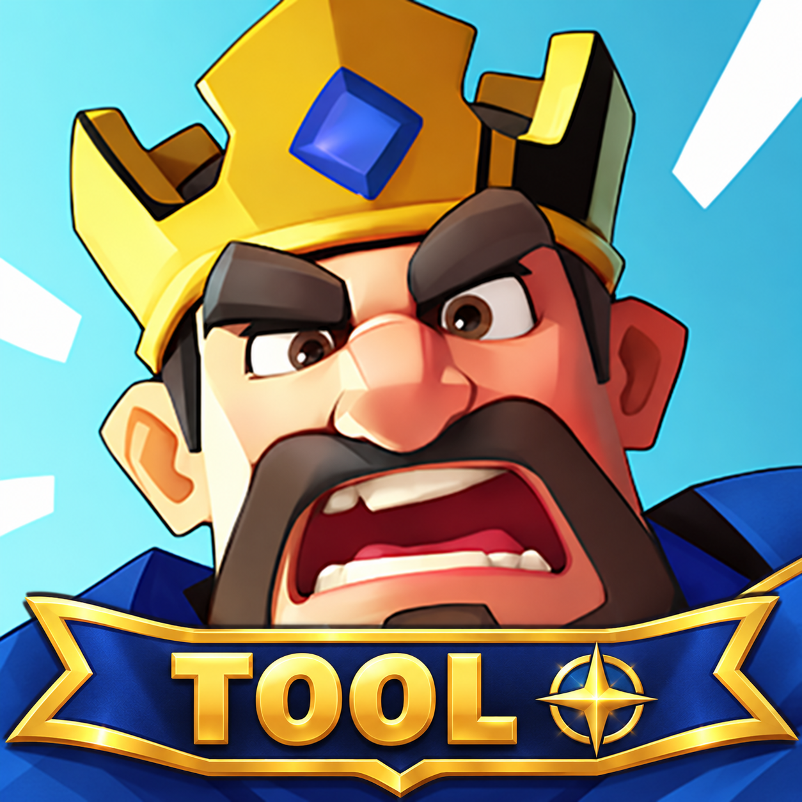
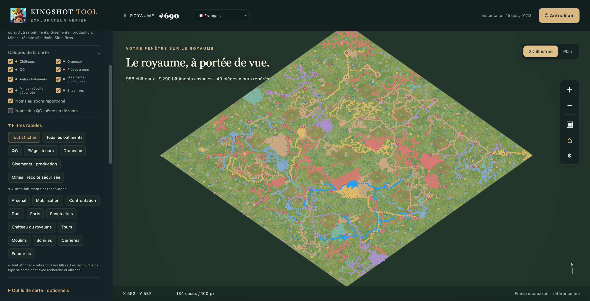
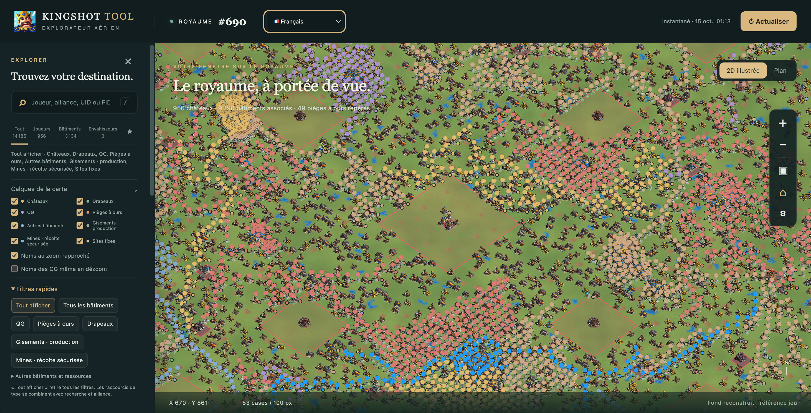
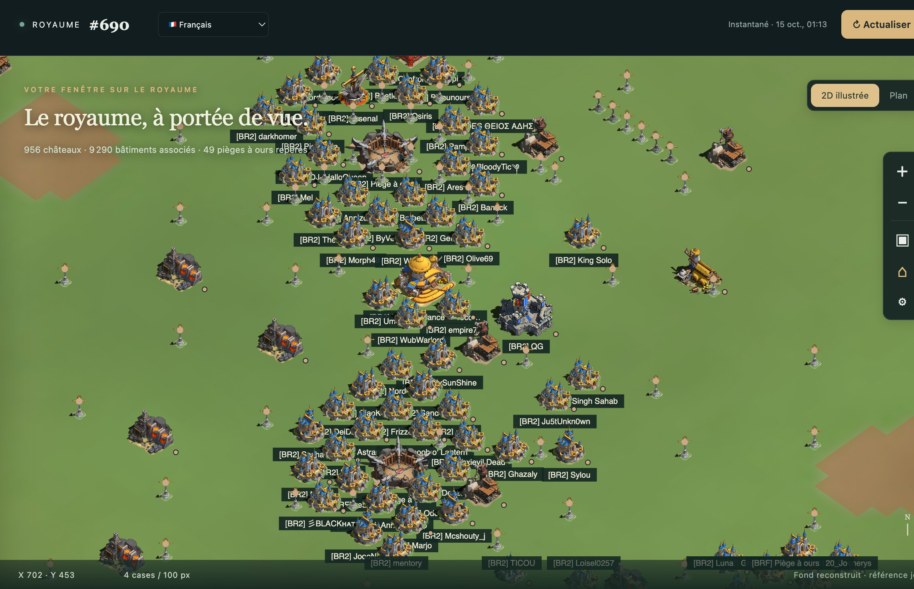
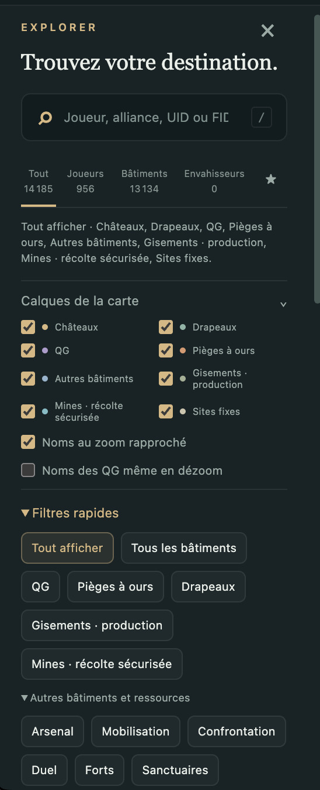
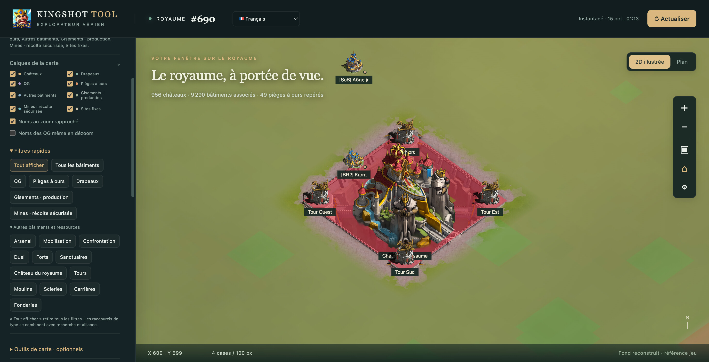
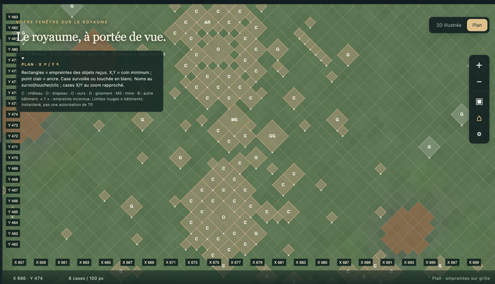

  

<h1 align="center">Kingshot Free Map Explorer · Royaume 690</h1>

  <strong>Explorez le royaume, trouvez une alliance et préparez vos coordonnées.</strong> 
  Une carte interactive pensée pour être simple à lire, sur ordinateur comme sur téléphone.

  <a href="./"><strong>Ouvrir l’atlas</strong></a> · <code>Carte interactive</code> · <code>18 langues</code> · <code>Sans compte</code>

## Commencer

1. **Ouvrez l’atlas** avec le lien ci-dessus.
2. **Cherchez** un joueur, une alliance ou un bâtiment.
3. **Cliquez sur un résultat** pour le centrer et afficher ses coordonnées.
4. **Zoomez et déplacez la carte** pour explorer les alentours.

Sur mobile, un doigt déplace la carte, deux doigts zooment et un toucher ouvre la fiche d’un lieu.

## Tout le royaume, en quelques gestes

| Pour… | Utilisez… |
| --- | --- |
| Retrouver un joueur ou une alliance | La barre de recherche et les filtres d’alliance. |
| Voir les châteaux, QG, drapeaux ou ressources | Les calques et les filtres rapides. |
| Rejoindre une position | « Aller à » avec les coordonnées X et Y. |
| Mesurer ou cadrer une zone | Les outils Distance et Zone. |
| Garder votre base à portée de main | « Mon château » — enregistré uniquement dans votre navigateur. |

### Voir une alliance dans son contexte

Les étiquettes et la disposition des bâtiments aident à lire les regroupements, puis à choisir un objet pour ouvrir sa fiche.

### Une barre latérale faite pour aller droit au but

  

Cherchez un nom, utilisez les filtres rapides, puis affinez par alliance et niveau. Les calques vous laissent afficher uniquement les châteaux, QG, drapeaux, pièges ou ressources dont vous avez besoin.

## Une carte agréable à explorer, précise quand il le faut

  

**Vue illustrée** pour parcourir le royaume et reconnaître les lieux d’un coup d’œil. **Vue Plan** pour lire les coordonnées et les empreintes sur la grille avec précision.

  

## Ce que cette version publique fait — et ne fait pas

- Elle affiche un **instantané** du royaume 690 : les positions ont pu évoluer depuis sa préparation.
- Elle est **entièrement statique** : aucune connexion au jeu, aucune actualisation en direct et aucun compte n’est nécessaire.
- Elle ne lance aucune action dans Kingshot : pas de téléportation, pas de commande et pas de modification de votre partie.
- Les filtres, les favoris et le choix de « Mon château » restent dans votre navigateur.
- L’interface est disponible en 18 langues et fonctionne dans un sous-dossier d’hébergement aussi bien qu’à la racine d’un site.

## Une question sur les données ?

Les coordonnées et objets affichés viennent d’un instantané public préparé pour la consultation. Certaines représentations visuelles (terrain, couleurs locales ou sprites proches) sont des aides de lecture : elles ne prétendent pas être une restitution native certifiée du jeu.

Bon repérage dans le royaume !
